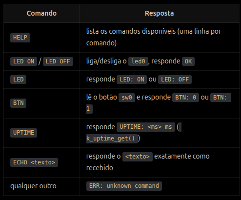

## Atividade 04 — Mini-shell via UARTCI

Construa uma pequena shell de comandos que convesa por UART, simulado por native ou com placa real, na placa real mandar vídeo mostrando o funcionamento, no `native_sim` a UART é um pseudo-terminal do linux: ao rodar o executável, o Zephyr  imprime algo como `uart_1 connected to pseudotty: /dev/pts/N`, e você conversa com o firmware abrindo esse caminho em outro terminal (`screen /dev/pts/N`, `picocom /dev/pts/N`, ou `echo "HELP" > /dev/pts/N`): suporte em link anexo.

**CONTEXTO:**

O console (printk) já usa a `uart0`. Para não misturar log com o canal de comandos, use a `uart1` ou use o subsistema de LOG do zephyr.

**REQUISITOS:**

1. Comunicação

* UART(RX) deve ocorrer por interrupção, sem pooling.
* ISR da interrupção apenas enfileira os bytes, sem parsing.
* Uma **thread** consome os bytes, monta linhas terminadas em `\n` ou
  `\r` e despacha o comando.
* **TX** das respostas pela `uart1` (transmissão você escolhe)), terminando cada resposta com
  `\r\n`.

1. Linha de comando

* 
* Buffer de linha de tamanho fixo (64 bytes) em Kconfig. Linha maior que isso
  deve ser descartada por inteiro e responder `ERR: line too long`.
* **Backspace** (`0x08` ou `0x7F`) apaga o último caractere digitado.
* **Eco** dos caracteres digitados de volta pela UART, e prompt `> `
  após cada resposta.

1. Comandos (case-insensitive))

**ARQUITETURA**

* **Tabela de comandos com function pointers.**
* **Separar camadas**: pelo menos um módulo de *parsing/dispatch*
  (sem nenhuma chamada de UART, GPIO ou `printk`, só recebe a linha e
  devolve/escreve a resposta num buffer) e um módulo de *transporte*
  (UART). O `main.c` só inicializa e conecta as partes.
* LED e botão obtidos pelo **devicetree.**

### Testes unitários

11. **Obrigatório**: testes unitários com **ztest** em
    app de teste próprio (ex.: `tests/unit/` com `CMakeLists.txt`,
    `prj.conf`, `testcase.yaml` e `src/`), rodando no `native_sim` via
    `west twister`.
